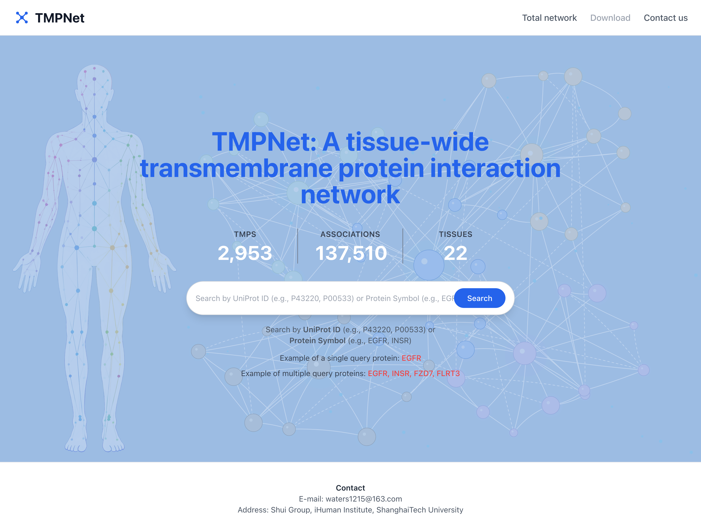

<div align="center">

# TMPNet

### A tissue-wide transmembrane protein interaction network — explore the full graph down to AlphaFold3 structure models.


<p>
  <a href="#quick-start">Quick Start</a> ◆
  <a href="#preview">Preview</a> ◆
  <a href="#docker-only-vm-deployment">Deployment</a> ◆
  <a href="#architecture">Architecture</a> ◆
  <a href="#api-summary">API</a>
</p>

</div>

## Why TMPNet?

TMPNet gives researchers one web surface to go from "how big is this
dataset" to "what does this specific interaction look like structurally",
without database or filesystem access.

- 🧬 **Whole-graph and focused views**: browse the full TMP interaction network, or search a UniProt accession or protein symbol.
- 🏷️ **Association sources**: every edge is labeled as TMPNet (predicted) or Additional (BioGRID, STRING or HitPredict).
- 🧱 **Structure-linked**: subgraph edges link to AlphaFold3 interaction models with per-residue confidence, viewable in the browser with NGL.
- 🐳 **Docker-only VM path**: one app image; the VM never needs Node.js, npm, psql, or the Supabase CLI.

## Quick Start

```bash
# 1. Install dependencies
npm install

# 2. Get the structure assets (not in Git; see "Data")
gh release download data-20260627 -R ENNCELADUS/MemPPI-Atlas -D /tmp/structures
tar -xzf /tmp/structures/best_structure-20260627.tar.gz -C data/raw/20260627_web_data/

# 3. Configure local file-mode data
cat <<'EOF' > .env.local
MEMPPI_DATA_MODE=file
MEMPPI_DATA_ROOT=data/supabase-import/20260627_web_data
STRUCTURE_ASSET_ROOT=data/raw/20260627_web_data/best_structure
EOF

# 4. Run the app
npm run dev
```

Open `http://localhost:3000/TMPNet`. The app is served under the base path
`/TMPNet` (`next.config.mjs`).

> **Prerequisites**: Node.js 20, npm, Git LFS (the data CSVs are LFS files).

## Preview

<div align="center">
  
  <p><sub>Cover page (<code>/TMPNet</code>) with network statistics, search and a preview of the full network.</sub></p>
</div>

**Typical workflow:**

1. Open `/TMPNet` and see the TMP, association and tissue counts.
2. Search a UniProt accession or protein symbol (for example `EGFR`, or `EGFR, INSR, FZD7, FLRT3`) to open `/TMPNet/subgraph?proteins=...`.
3. Inspect the graph and the node and edge tables, and open a linked AlphaFold3 model at `/TMPNet/structures/[modelId]`.

## Current App Surface

- `/` is the cover page with summary counts, search and query examples.
- `/network` shows the full network from a prebuilt artifact, with network
  statistics and the family legend.
- `/subgraph?proteins=...` resolves UniProt IDs and protein symbols, then shows
  a focused neighborhood (one protein) or the associations among several
  proteins. Identifiers that are not found are listed in a warning.
- `/structures/[modelId]` renders an AlphaFold3 interaction model with
  confidence summaries and asset downloads.

All paths are prefixed with `/TMPNet`.

## Tech Stack

- Next.js 14 (Pages Router) + React 18 + TypeScript 5
- Local CSV data adapter (file mode) for the Docker-only VM deployment
- Cytoscape.js + `cytoscape-fcose`; NGL 2.3.0 from a CDN with an SRI hash
- Tailwind CSS
- Jest + React Testing Library; GitHub Actions CI

## Configuration

**File mode** (used by the Docker image): reads graph and structure data from
local files.

```env
MEMPPI_DATA_MODE=file
MEMPPI_DATA_ROOT=data/supabase-import/20260627_web_data
STRUCTURE_ASSET_ROOT=data/raw/20260627_web_data/best_structure
```

**Supabase mode**: used when `MEMPPI_DATA_MODE` is not `file`.

```env
NEXT_PUBLIC_SUPABASE_URL=...
NEXT_PUBLIC_SUPABASE_ANON_KEY=...
# Optional; defaults to "structure-models"
SUPABASE_STRUCTURE_BUCKET=structure-models
NEXT_PUBLIC_SUPABASE_STRUCTURE_BUCKET=structure-models
```

> **Security note**: never commit real credentials. `.env*` files are in
> `.gitignore`.

## Docker-only VM Deployment

CI builds the app image on every push to `main` and publishes it to GitHub
Packages as `ghcr.io/enncelados/memppi-atlas`. On a VM with registry access:

```bash
docker login ghcr.io
docker pull ghcr.io/enncelados/memppi-atlas:latest
docker tag ghcr.io/enncelados/memppi-atlas:latest memppi-atlas:file-data
docker compose --env-file .env.vm up -d
```

For a VM without registry access, build an offline bundle with
`npm run docker:vm:bundle` and run `./load-and-run.sh` on the VM.

The VM does not need Node.js, npm, npx, psql, or the Supabase CLI. The VM stack
runs only the Next.js app container, with the 20260627 graph data and the
0407-derived structure assets built into the image.

See [docs/vm-deployment.md](docs/vm-deployment.md).

## Architecture

TMPNet is a single Next.js app with three runtime concerns: graph APIs over a
data adapter, client-side Cytoscape rendering, and NGL structure viewing.

```text
┌─────────────┐  /api/network        ┌──────────────────┐
│  /network   │ ────────────────────▶│  Prebuilt        │  public/generated/network/
├─────────────┤  /api/network/stats  │  artifacts       │  (overview + stats)
│  /subgraph  │ ────────────────────▶├──────────────────┤
├─────────────┤  /api/subgraph       │   Data adapter   │  file mode: CSVs under data/
│/structures/ │ ────────────────────▶│  (nodes, edges,  │  Supabase mode: tables
│  [modelId]  │  /api/structures/*   │ structure_models)│
└─────────────┘                      └──────────────────┘
```

See [docs/architecture.md](docs/architecture.md).

## Data

| Path                                                | Content                                  | Storage                 |
| --------------------------------------------------- | ---------------------------------------- | ----------------------- |
| `data/supabase-import/20260627_web_data/*.csv`      | Runtime nodes, edges, structure manifest | Git LFS                 |
| `data/00.Web_*_20260627.csv`, `data/0713.Web_*.csv` | Raw exports used by `prepare:data`       | Git LFS                 |
| `data/raw/20260627_web_data/best_structure/`        | AlphaFold3 CIF and JSON files            | Release `data-20260627` |
| `model/models/**/*.pth`                             | Sequence-model weights                   | Not public; on request  |

See [data/README.md](data/README.md) and [model/README.md](model/README.md).

## Scripts

| Command                                       | Purpose                                                            |
| --------------------------------------------- | ------------------------------------------------------------------ |
| `npm run dev` / `build` / `start`             | Develop, build and serve the app                                   |
| `npm run lint` / `typecheck` / `format:check` | Static checks (also run in CI)                                     |
| `npm test` / `test:coverage`                  | Jest tests; coverage floor 70%                                     |
| `npm run prepare:data`                        | Rebuild the import CSVs from the raw exports and structure folders |
| `npm run build:network-artifacts`             | Rebuild `public/generated/network/*` from the import CSVs          |
| `npm run docker:vm:bundle`                    | Build the offline VM bundle (needs Docker)                         |

## API Summary

- `GET /api/network`: the network as JSON or Cytoscape elements, with layout metadata.
- `GET /api/network/stats`: node, edge, family, enriched-edge and predicted-edge counts.
- `GET /api/subgraph?proteins=EGFR,INSR`: a focused graph for the identifiers.
- `POST /api/layout-cache`: stores computed node positions for a graph key.
- `GET /api/structures/[modelId]`: structure, edge, protein, asset-link and confidence data.
- `GET /api/structures/[modelId]/asset?kind=cif|summary|confidences`: one structure file.

See [docs/api.md](docs/api.md).

## Contributing

Use a branch and a pull request. Commits follow Conventional Commits
(`feat:`, `fix:`, `refactor:`, `docs:`, `chore:`). Use the `@/` import alias
and Prettier formatting. CI runs these checks on every pull request:

```bash
npm run lint
npm run typecheck
npm run format:check
npm test
npm run build
```

Include a short problem statement, test evidence, and screenshots for UI
changes. A release happens when a merge to `main` carries a new
`package.json` version: CI tags `v<version>`, creates the GitHub release and
pushes the image tag.

## License

Copyright (c) 2026 Shui Group, iHuman Institute, ShanghaiTech University.

This repository and its release assets, including the code, the data files
and the structure archive, are licensed under the
[PolyForm Strict License 1.0.0](LICENSE). You may use them for noncommercial
purposes only. You may not distribute them or make changes or new works based
on them. For other uses, contact the Shui Group.

## Acknowledgments

Structure models are derived from **AlphaFold3** interaction predictions.

## Documentation Map

- [Architecture](docs/architecture.md)
- [API Reference](docs/api.md)
- [Data Model](docs/data-model.md)
- [UI Specification](docs/ui-spec.md)
- [VM Deployment](docs/vm-deployment.md)
- [Architecture Decision Records](docs/adr/)
- [Domain Glossary](CONTEXT.md)
